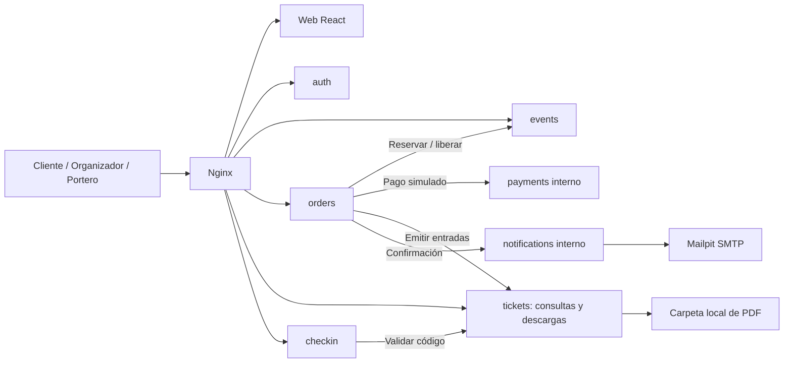

# Plan de implementación - EntradasYa v1

> Equipo de 6 personas · presentación local permitida
> Fuente: EntradasYa_v1_Requerimientos.pdf, versión 1.0, y aclaraciones del equipo.
> Estado: propuesta de trabajo. Las casillas representan tareas pendientes, no funcionalidades implementadas.

Los identificadores A1-F7 y V1-V12 son propios de este plan, no códigos de requisitos del PDF. Los mecanismos de recuperación ante fallos amplían el mínimo escrito; se priorizan primero el flujo completo y los errores exigidos por el docente.

## 0. Alcance y decisiones

Construiremos el sistema completo: registro, catálogo, compra, pago simulado, entradas PDF con QR, confirmación en Mailpit e ingreso al evento sin reutilizar entradas.

**Aclaraciones confirmadas por el equipo:**

- Los seis integrantes desarrollarán los ocho componentes del documento.
- Los lenguajes sugeridos son opcionales.
- Para esta presentación el docente todavía no exige pipeline ni despliegue automatizado.

**Decisiones propuestas para llegar a la entrega:**

| Tema | Propuesta |
|---|---|
| Repositorio | Un monorepo llamado `entradasya`, con una carpeta por servicio. |
| Web | React + Vite + TypeScript, una sola interfaz con vistas por rol. |
| Backend | Node.js + TypeScript + Express para los siete servicios. Si alguien cambia de lenguaje, conserva el mismo contrato HTTP. |
| Datos | Un PostgreSQL local, seis bases y seis usuarios independientes. |
| Comunicación | REST por HTTP/JSON; cada petición entre servicios tiene timeout. |
| Entrada al sistema | Nginx sirve la web y enruta las APIs públicas. |
| Ejecución | Procesos independientes iniciados localmente mediante comandos documentados. |
| Correo | Mailpit instalado como binario local, sin envío de correos reales. |
| Archivos | PDF en una carpeta persistente local, fuera de Git y de las carpetas de releases. |
| Entrega | Flujo completo funcionando en la computadora local; sin exigir VM ni pipeline. |
| Infraestructura cloud | Terraform y AWS se dejan para otra etapa. |

El documento cuenta **ocho componentes: una web y siete servicios backend**. `web` y `notifications` no necesitan base de datos. Nginx, PostgreSQL y Mailpit son infraestructura de apoyo.

La v1 excluye Docker, RabbitMQ, Redis, S3/MinIO, Kubernetes, pagos reales y correo real. Aunque el PDF menciona un pipeline, la aclaración posterior del docente lo deja fuera de esta presentación. Se presenta la ejecución local, sin AWS, Terraform, runner, VM obligatoria ni despliegue automatizado.

## 1. Monorepo y estructura

El monorepo facilita revisar contratos y cambios relacionados en un PR. Cada backend conserva su proceso, configuración, dependencias, migraciones y README. Para comunicarse usa HTTP; no importa directamente el código de otro servicio ni accede a su base.

```text
entradasya/
├── apps/
│   └── web/
│       └── src/features/
│           ├── auth/          # P1
│           ├── events/        # P2
│           ├── orders/        # P3
│           ├── payments/      # P4: formulario, no acceso directo a payments
│           ├── tickets/       # P5
│           └── checkin/       # P6
├── services/
│   ├── auth/
│   ├── events/
│   ├── orders/
│   ├── payments/
│   ├── tickets/
│   ├── notifications/
│   └── checkin/
├── contracts/
│   ├── conventions.md
│   ├── auth.openapi.yaml      # Un contrato por servicio, siete en total
│   └── ...
├── infra/
│   ├── nginx/
│   └── postgres/              # Crear bases y usuarios; no contiene claves reales
├── scripts/
│   ├── dev/
│   └── smoke/
├── tests/integration/
├── docs/
│   ├── plan-implementacion.md
│   ├── arquitectura.md
│   ├── bitacora.md
│   ├── demo.md
│   └── contribuciones.md
├── .gitignore
└── README.md
```

Cada backend debe contener `src/`, `.env.example`, `README.md`, scripts de ejecución y sus pruebas críticas. Los seis servicios con datos también incluyen `migrations/`.

No crear una librería común de entidades de negocio, repositorios ni modelos ORM. Compartir contratos y convenciones basta para esta entrega.

## 2. Arquitectura y datos



| Servicio | Puerto propuesto | Base propia | Dueño de sus datos |
|---|---:|---|---|
| auth | 3001 | `auth_db` | Usuarios, hash de contraseña y roles. |
| events | 3002 | `events_db` | Eventos, sectores, precios y reservas de cupos. |
| orders | 3003 | `orders_db` | Órdenes, detalle de compra y avance de la operación. |
| payments | 3004 | `payments_db` | Transacción y resultado por orden. |
| tickets | 3005 | `tickets_db` | Entradas, comprador, código y ubicación del PDF. |
| notifications | 3006 | Ninguna | Solo envío SMTP y logs. |
| checkin | 3007 | `checkin_db` | Ingresos, hora, portero y ticket utilizado. |

Puertos adicionales propuestos: Nginx `8080`, Vite en desarrollo `5173`, PostgreSQL `5432`, Mailpit SMTP `1025` y su interfaz `8025`. Todos son configurables por entorno.

### Papel de Nginx en local

Nginx es la puerta de entrada del navegador: una URL como `http://localhost:8080` sirve la web y dirige `/api/auth/*` hacia auth, `/api/events/*` hacia events, etc. Para la demo puede servir los archivos compilados de React; durante el desarrollo también puede reenviar la web al servidor de Vite.

Las llamadas internas siguen siendo directas: orders llama a events/payments/tickets/notifications por sus direcciones configuradas. No hace falta enviar esa comunicación por Nginx. Un sistema puede funcionar sin Nginx, pero se mantiene en este plan porque la arquitectura del PDF lo incluye explícitamente; además evita que la web tenga que manejar un puerto diferente para cada API.

Cada base tiene un usuario diferente con permisos únicamente sobre sus propios datos. Las relaciones con otros servicios son IDs y copias de datos necesarias para la operación; no hay consultas ni claves foráneas entre bases.

### Convenciones que se acuerdan antes de programar

- IDs UUID; fechas ISO 8601 en UTC y presentación en hora local.
- Importes en unidades menores enteras, por ejemplo `priceMinor=5000`, y una moneda acordada. El servidor calcula el total a partir del precio de events.
- Estados API en inglés: eventos `draft/published/cancelled`; órdenes `pending/paid/rejected/cancelled`. La web muestra sus equivalentes en español.
- Éxitos HTTP con JSON; errores con `{ error: { code, message }, requestId }`.
- Errores de negocio distinguibles: `SOLD_OUT`, `PAYMENT_REJECTED`, `ALREADY_USED`, `WRONG_EVENT`, `INVALID_TICKET`.
- `400` para datos inválidos, `401/403` para acceso, `404` para inexistentes y `409` para conflictos. Un pago rechazado tiene resultado de negocio, no un `500`.
- `GET /health` en cada backend: responde `200` si puede atender su función y `503` si falta una dependencia indispensable. Verifica su base cuando corresponda. La web y Nginx se verifican por HTTP.
- Logs a consola con fecha, nivel, servicio, mensaje y `requestId`; sin contraseñas, tokens ni datos completos de tarjetas.
- Timeouts configurables: comenzar con 5 segundos por llamada, con un límite mayor y acotado para generar PDF. Una compra no puede quedar esperando indefinidamente.

## 3. Reparto entre seis personas

La carga se reparte por funcionalidad completa. El frontend se construye desde el primer día y cada dueño integra su parte. Los dos servicios internos más pequeños quedan juntos para equilibrar el trabajo.

### Preparación previa al reparto - en curso

La creación del repositorio y de la estructura de carpetas está a cargo de quien está preparando el proyecto. Se registra como una contribución previa y no se vuelve a asignar como tarea pendiente de P1.

- [ ] Crear el repositorio, la rama principal y las carpetas acordadas.
- [ ] Dejar el `.gitignore` y un README raíz inicial con la estructura y el reparto.

Esta preparación no incluye implementar los servicios: cada responsable inicializa su backend y su parte de la web dentro de las carpetas correspondientes. Las convenciones comunes se acuerdan entre todos.

| Persona | Responsabilidad principal | Parte de la web | Dependencia para integrar |
|---|---|---|---|
| **P1** | auth + contrato de autenticación y acceso | Registro, login, sesión y navegación por rol | Ningún otro backend. |
| **P2** | events: catálogo, edición, sectores y cupos | Cartelera, detalle, gestión de eventos y vista de ventas | JWT; reporte de P3 para ventas. |
| **P3** | orders: coordinación de compra y consultas | Checkout, resultado y mis compras | Contratos de P2, P4 y P5. |
| **P4** | payments + notifications + Mailpit + preparación de PostgreSQL | Componente de datos del pago simulado | Puede trabajar con órdenes de ejemplo. |
| **P5** | tickets: emisión, PDF, QR y descargas | Mis entradas y descarga | Datos de compra definidos con P3. |
| **P6** | checkin + Nginx + arranque y verificación local | Portería: código, resultado y conteo | Contrato de validación de P5. |

### P1 - Autenticación y acceso

- [ ] A1. Inicializar el servicio auth dentro de la estructura existente: conexión a `auth_db`, migraciones, `.env.example` y scripts de ejecución.
- [ ] A2. Implementar configuración, `/health`, logs y manejo de errores de auth. Cada responsable prepara estos elementos en su propio servicio.
- [ ] A3. Definir el contrato de autenticación y JWT con los servicios consumidores. Los contratos de negocio, puertos y llamadas internas se acuerdan entre todos.
- [ ] A4. Implementar registro e inicio de sesión; contraseñas con hash seguro y JWT firmado. Cada servicio valida localmente firma, expiración y claims acordados.
- [ ] A5. Registro público solo de clientes. Crear organizador y portero mediante una semilla/script de demo, sin permitir elevar el rol desde el formulario público.
- [ ] A6. Implementar sesión, cierre de sesión, rutas por rol y navegación base de la web. Mantener la sesión al recargar y gestionar token vencido.
- [ ] A7. Documentar el arranque de auth y apoyar la integración del acceso con los demás servicios. Cada integrante documenta su componente y escribe su sección de la bitácora y contribuciones.

**Contrato temprano:** entregar un token de ejemplo válido, claims y claves de verificación durante las primeras dos horas. Acordar `sub`, `role`, `email`, `iss`, `aud` y `exp`; el correo firmado permite a orders preparar la confirmación sin consultar auth. Propuesta: firma asimétrica, privada solo en auth y pública en los consumidores. No incluir claves reales en Git.

**Terminado cuando:** un cliente se registra e inicia sesión, el token sirve en otro backend sin consultar auth y un cliente no puede entrar a una operación de organizador.

### P2 - Eventos y cupos

- [ ] B1. Migraciones de eventos, sectores y reservas en `events_db`.
- [ ] B2. Crear, editar, publicar y cancelar eventos; guardar imagen como URL para evitar un sistema de subida de archivos en esta entrega.
- [ ] B3. Listado público solo de publicados; listado privado de los eventos propios, incluidos borradores. El organizador solo modifica sus eventos.
- [ ] B4. Sectores con precio y capacidad; reserva y liberación por `orderId`.
- [ ] B5. Descontar cupos en una transacción con bloqueo o actualización condicional. Repetir la misma reserva no descuenta otra vez; repetir la liberación tampoco suma dos veces. Una edición no puede reducir capacidad por debajo del cupo ya comprometido.
- [ ] B6. Implementar cartelera, detalle y formulario del organizador. Mostrar sus ventas e ingresos consumiendo el reporte de orders, no leyendo su base.

**Terminado cuando:** dos compras concurrentes por el último cupo no pueden ser aprobadas ambas; un pago rechazado permite recuperar exactamente los cupos reservados.

### P3 - Órdenes y compra

- [ ] C1. Migraciones de órdenes, detalle e identificadores de reintento en `orders_db`.
- [ ] C2. Compra de 1 a 6 entradas de un sector de un evento; identidad y correo del cliente tomados del token validado.
- [ ] C3. Coordinar `events -> payments -> tickets -> notifications`, guardando el avance de cada paso.
- [ ] C4. Pago rechazado: liberar reserva y marcar rechazada. Notificación fallida: mantener compra pagada.
- [ ] C5. Consultas de compras propias y reporte de ventas/ingresos por evento para su organizador. Contabilizar ingresos de órdenes pagadas.
- [ ] C6. Checkout, resultado y listado de compras. Integrar el componente de pago de P4.
- [ ] C7. Reintento con el mismo identificador de compra: no crear otra orden, cobrar otra vez ni emitir entradas duplicadas.

**Terminado cuando:** una compra completa genera las entradas y un correo; las variantes sin cupo, pago rechazado y notifications apagado producen el resultado esperado.

### P4 - Pago, correo y soporte de datos

- [ ] D1. Crear script/documentación para las seis bases y sus usuarios; cada dueño conserva sus propias migraciones y credenciales.
- [ ] D2. payments: regla fija de demo, por ejemplo terminación `0000` rechaza y `1111` aprueba. No usar datos ni dinero reales.
- [ ] D3. Registrar monto, fecha y resultado con unicidad por `orderId`. Repetir el pedido devuelve la misma transacción; un monto diferente para esa orden se rechaza.
- [ ] D4. notifications: recibir destinatario y datos de confirmación, enviar enlace a las entradas por SMTP a Mailpit. No necesita base.
- [ ] D5. Instalar/documentar Mailpit como binario y dejar accesible su interfaz de pruebas.
- [ ] D6. Implementar `PaymentFields` en la web; el formulario envía sus datos a orders, nunca directamente a payments.
- [ ] D7. Restringir payments y notifications a llamadas internas autenticadas de orders.

**Terminado cuando:** repetir un cobro conserva una sola transacción y se ve una confirmación en Mailpit. Al apagar notifications, orders no pierde ni revierte la compra.

### P5 - Entradas, PDF y QR

- [ ] E1. Migraciones de entradas en `tickets_db`; código impredecible y único por entrada.
- [ ] E2. Emitir una entrada por unidad comprada; unicidad por `(orderId, número de entrada)` para soportar reintentos.
- [ ] E3. Crear PDF con evento, fecha, lugar, sector, identificador y QR; almacenar fuera del repositorio y de releases.
- [ ] E4. Aceptar emisión solamente desde orders, con datos de una compra aprobada. Recibe la copia necesaria de los datos; no consulta las bases ni APIs de events/payments.
- [ ] E5. Listar/descargar entradas solo del comprador autenticado. No exponer directamente la carpeta mediante Nginx.
- [ ] E6. Validación interna para checkin: código existente, evento y validez. El estado de uso lo administra checkin.
- [ ] E7. Implementar Mis entradas y descarga del PDF.

**Terminado cuando:** comprar tres unidades entrega tres códigos y tres PDF legibles; reintentar la emisión no crea otros tres. Otro cliente no puede descargarlos.

### P6 - Ingreso y ejecución

- [ ] F1. checkin: consultar tickets y registrar ticket, evento, fecha/hora y portero en `checkin_db`.
- [ ] F2. Rechazar código inválido, evento distinto y entrada utilizada; mostrar la hora del primer ingreso.
- [ ] F3. Garantizar un único ingreso por `ticketId` con una restricción de base de datos, también ante dos escaneos concurrentes.
- [ ] F4. Pantalla de portería con selección de evento, entrada manual/lector de código, resultado claro y conteo. Priorizar un código escrito o lector que actúe como teclado; cámara del navegador después, según tiempo y permisos.
- [ ] F5. Configurar Nginx: web y rutas públicas; bloquear `/internal/*` y no publicar payments/notifications. Backends escuchan en loopback en el servidor local.
- [ ] F6. Preparar comandos o un script de arranque/parada local, con revisión de P1 y variables entregadas por cada dueño; systemd no es requisito de esta presentación.
- [ ] F7. Documentar la instalación local, verificar la salud de los servicios y probar el reinicio sin perder datos ni PDF. Comenzar esta preparación el primer día.

**Terminado cuando:** dos intentos sobre el mismo QR permiten un solo ingreso, y el sistema se puede reiniciar siguiendo la documentación.

## 4. Contratos mínimos de integración

Estas rutas son una **propuesta**, no rutas obligatorias del PDF. Confirmarlas durante las primeras dos horas y guardarlas en `contracts/`. Cada dueño entrega ejemplos reales de petición, respuesta y error. La descarga del PDF es binaria; el resto de los datos se intercambia como JSON.

| Servicio | Endpoints públicos mediante Nginx | Endpoints internos principales |
|---|---|---|
| auth | `POST /api/auth/register`, `POST /api/auth/login` | Ninguno. |
| events | `GET /api/events`, `GET /api/events/:id`, CRUD del organizador bajo `/api/events` | `POST /internal/reservations`, `POST /internal/reservations/:orderId/release`. |
| orders | `POST /api/orders`, `GET /api/orders/me`, `GET /api/orders/:id`, reporte `GET /api/orders/reports/events/:eventId` | Ninguno necesario para esta v1. |
| payments | Ninguno. | `POST /internal/payments`, `GET /internal/payments/orders/:orderId`. |
| tickets | `GET /api/tickets/me`, `GET /api/tickets/:id/pdf` | `POST /internal/tickets/issue`, `POST /internal/tickets/validate`. |
| notifications | Ninguno. | `POST /internal/notifications/purchase`. |
| checkin | `POST /api/checkin`, `GET /api/checkin/events/:eventId/count` | Ninguno necesario. |

Las rutas concretas de editar/publicar/cancelar eventos y de reintentar órdenes se completan en los contratos de sus dueños. Nginx y el backend deben acordar si el proxy conserva `/api`; no usar reglas diferentes por accidente.

### Datos que deben cerrar P2, P3, P4 y P5

1. **Compra desde la web:** `eventId`, `sectorId`, `quantity` y datos ficticios del pago. Lleva una clave de idempotencia estable para los reintentos de esa compra. No acepta un precio decidido por el cliente.
2. **Reserva en events:** `orderId`, `eventId`, `sectorId`, `quantity`. Devuelve reserva y copia de nombre/fecha/lugar del evento, sector, precio, moneda y organizador.
3. **Pago:** `orderId`, importe calculado, moneda y medio ficticio. Devuelve `transactionId` y `approved/rejected`.
4. **Emisión:** `orderId`, comprador, cantidad y copia de evento/sector. Devuelve los IDs de tickets y rutas autenticadas de descarga.
5. **Correo:** destinatario validado, resumen y enlace público a Mis entradas; no incluir el JWT en la URL.
6. **Ingreso:** código y evento seleccionados por el portero. tickets confirma la entrada; checkin decide y registra el uso.

Para las llamadas internas, utilizar credenciales por par emisor/receptor en variables de entorno, por ejemplo un token que solo conozcan orders y payments. Un JWT de cliente no autoriza la API interna. No confiar en un `userId` o rol recibido del navegador.

## 5. Consistencia y fallos que sí debemos resolver

Las operaciones se ejecutan en bases diferentes. No hay una transacción SQL que incluya a todos los servicios; orders coordina y registra los pasos para poder repetirlos.

| Situación | Comportamiento acordado |
|---|---|
| Dos compradores intentan el último cupo | events reserva de forma atómica; solo uno lo obtiene. |
| No hay cupo | No llamar a payments; mostrar agotado y cerrar la orden sin cobro. |
| Pago rechazado | Liberar la reserva una vez; orden rechazada. Si falla la liberación, guardar que está pendiente y reintentarla sin sumar cupo dos veces. |
| El pago tiene timeout | El resultado es desconocido. Consultar por el mismo `orderId` o repetir idempotentemente; mantener pendiente, sin asumir rechazo ni liberar cupos a ciegas. |
| Pago aprobado, tickets falla | Conservar orden pagada y emisión pendiente. Reintentar emisión sobre la misma orden, sin nuevo cobro ni liberar sus cupos. |
| notifications falla | Compra pagada y tickets descargables; registrar aviso/fallo de correo. |
| Se repite la compra por doble clic o timeout | Reusar la misma clave y orden; comprobar también en backend. Deshabilitar el botón no basta. |
| Se repite emisión de tickets | Mantener los mismos registros/códigos y completar archivos faltantes. |
| Se escanea un QR dos veces o al mismo tiempo | Un solo ingreso persistido; el segundo devuelve utilizado y hora del primero. |

El avance auxiliar de orders puede guardarse como `reservationStatus`, `paymentStatus`, `ticketStatus` y `notificationStatus`, sin añadir estados de negocio distintos a los del documento. Un endpoint de reintento autenticado sobre la misma orden permite recuperar estos pasos sin introducir colas. Dos ejecuciones de la misma orden deben serializarse mediante un mecanismo persistente, no solo una bandera en memoria.

## 6. Orden de trabajo

**Primer requisito para integrar:** contratos y JWT de P1. **Ruta crítica de compra:** events + payments -> orders -> tickets. **Ingreso:** tickets -> checkin. **Correo:** se conecta en paralelo y su caída no bloquea la compra.

P3 no espera a que terminen cuatro servicios para comenzar: usa respuestas HTTP de ejemplo, sustituidas por servicios reales antes de la demo. P6 trabaja primero en ejecución y gateway mientras P5 desarrolla la validación.

## 7. Ejecución local y trabajo con Git

### Desarrollo y entrega local

- Cada servicio debe poder iniciarse desde su README. El README raíz explica el arranque conjunto y el orden de preparación de datos.
- En Ubuntu instalar runtimes, PostgreSQL, Nginx y Mailpit directamente; la v1 no requiere contenedores.
- `.env.example` enumera las variables y usa valores ficticios. Archivos `.env`, claves de firma, PDF, logs y datos de PostgreSQL quedan fuera de Git.
- Variables comunes de backends: `PORT`, conexión a su base cuando aplique, verificación JWT para APIs públicas, URLs/credenciales de los servicios que consume y timeout HTTP.
- tickets añade `TICKETS_STORAGE_DIR`; notifications añade SMTP y `PUBLIC_WEB_URL`; auth contiene la clave privada de firma. La web solo recibe configuración pública y utiliza rutas `/api` del gateway.
- P4 prepara un procedimiento de creación de bases; cada dueño entrega migraciones y semillas idempotentes para su servicio.

### Ramas y responsabilidades

- Rama principal acordada al inicio (`main` o `master`), con ramas `feat/auth`, `feat/events`, etc. y PR pequeños.
- La persona que prepara el repositorio deja la estructura raíz inicial. P1 se encarga de la navegación y el acceso compartidos; P6 de Nginx y arranque local. Los cambios posteriores en archivos comunes se coordinan entre todos para reducir conflictos.
- Cada dueño modifica su carpeta de backend y su feature de frontend. P4 entrega su componente de pago; P3 lo integra sin reescribirlo.
- Cambios de contrato requieren avisar al consumidor y actualizar ejemplos. No cambiar estados, nombres de campos o prefijos unilateralmente.
- Hacer una integración al terminar el primer día y otra al comenzar el segundo; evitar juntar seis ramas al final.

## 8. Verificación mínima de aceptación

Estas pruebas cubren reglas del proyecto y comunicación real. No hace falta una batería de pruebas repetitivas de getters o estructura de carpetas.

| ID | Escenario | Responsables |
|---|---|---|
| V1 | Seguir README desde un entorno preparado y comprobar salud de cada componente. | Cada dueño + P6. |
| V2 | Registro/login, acceso por rol y rechazo de descarga de otro cliente. | P1 + P5. |
| V3 | Crear/publicar evento y comprar entre 1 y 6 entradas; rechazar cantidad 7. | P2 + P3. |
| V4 | PDF y QR por unidad, confirmación en Mailpit y descarga desde web. | P3 + P4 + P5. |
| V5 | Primer ingreso aprobado; segundo rechazado con hora. Probar también otro evento y código inexistente. | P5 + P6. |
| V6 | Sector agotado y dos peticiones por el último cupo: no hay sobreventa. | P2 + P3. |
| V7 | Pago rechazado: cupos recuperados; repetir liberación no aumenta capacidad. | P2 + P3 + P4. |
| V8 | Repetir compra/cobro/emisión: una orden, una transacción y cantidad correcta de tickets. | P3 + P4 + P5. |
| V9 | Apagar notifications: compra pagada, PDF disponible y fallo registrado. | P3 + P4. |
| V10 | Reintentar emisión tras fallo sin un nuevo cobro; comprobar recuperación de un pago con respuesta incierta. | P3 + P4 + P5. |
| V11 | Organizador ve ventas/ingresos de sus eventos y no modifica eventos ajenos. | P1 + P2 + P3. |
| V12 | Levantar, detener y reiniciar el sistema local siguiendo el README, sin perder PDF ni datos. | P6 + todos. |

La lectura/validación de cupos y la verificación de QR no bastan si el registro posterior puede competir con otra petición. Usar transacciones y restricciones de unicidad en PostgreSQL para los casos V6 y V5/V8.
